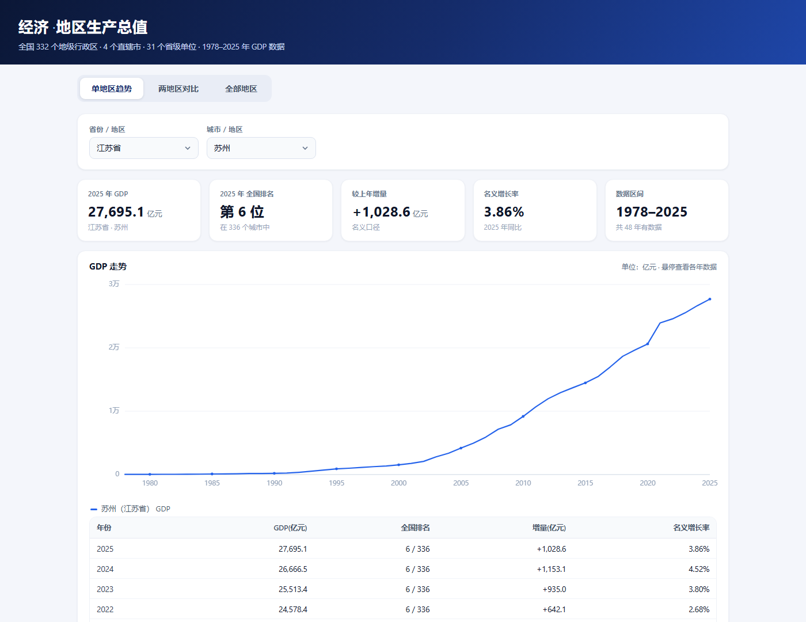

# 经济 · 地区生产总值

> 一个零依赖、纯静态的全国城市 GDP 可视化站点：单个地区看走势，两个地区比差距，全部地区查排名。



打开即用——所有数据已内联进 `index.html`，不需要服务器、不需要联网、没有构建依赖，双击就能看。

---

## 功能

### 1. 单地区趋势

- **双层选择**：先选省份，再选城市；全国、4 个直辖市、27 个省区、332 个地级行政区全部可查，共 364 个对象。
- **指标卡**：当年 GDP、全国排名、较上年增量、名义增长率、**实际增长率**、数据区间。
- **折线图**：1978–2025 年 GDP 走势，鼠标悬停显示该年数值；缺失年份显示「未公开」，不会画成 0。
- **数据表**：年份 / GDP / 全国排名 / 增量 / 名义增长率 / 实际增速，逐年列出。
- **入场动画**：切换地区时，折线自左向右推进绘制（约 0.6 秒），便于感知走势方向。
- **单年详情页**：点击表格中的任一年份，进入该年的详情页——总量、增量、名义增长率、实际增长率，顶部可「← 上一年 / 下一年 →」连续翻看，并以圆环图显示三次产业占比（地级市暂缺实际增速与产业结构，自动略去）。

> **全国排名**口径：城市（含 4 个直辖市）在 336 个城市中排名，省区在 31 个省级单位中排名，两者不混排；逐年独立计算，可看出名次升降。

### 2. 两地区对比

- A、B 两组独立选择器，城市对城市、城市对全省、省对全国都可以。
- 顶部给出结论句，例如：
  > 2025 年，深圳的 GDP 为 38,731.8 亿元，相当于广州（32,039.5 亿元）的 **120.9%**，即深圳是广州的 1.21 倍。
- 双折线对比图 + 逐年对比表：年份 / A GDP / B GDP / **A 占 B** / A 增速 / B 增速。

### 3. 多地区对比

- 最多可同时选择 **5 个**地区（省、市、全国皆可），每个地区一种颜色。
- 只显示各地区的 GDP 走势与逐年数值：**不含占比、不含增长率**；同一地区重复选择时只保留一次。
- 五条折线共用一个坐标轴，配图例与逐年数值表；悬停时气泡一次列出各地区该年 GDP，便于横向比较。

### 4. 增速换算

- 只选**起始年份**，终止年份自动 +1（单年口径）。
- 填入两年数据后，自动输出：**名义增速、实际增速、名义增量、终止年国内生产总值指数（1978年=100）**。
- 切换年份会自动带入全国两年数据；手动改动数据即按自定义数值计算名义口径，实际增速按不变价折算（全国 GDP 平减指数）。
- 指数口径与统计公报的初步核算数可能相差 0.1—0.3 个百分点。

### 5. 全部地区

- 按 **全国 / 省级 / 市级** 三档分列，每档独立成表。
- 省级与市级按汉语拼音首字母排序（字典序），市级保留「省份」列以便区分归属。
- 顶部搜索框对三档同时生效，支持**中文**与**拼音**（全拼 `suzhou` 或首字母 `sz` 均可）；每行的「看趋势」直接跳转到该地区的折线图。
- 排序可切换：**拼音序 / GDP 降序 / 名义增速降序**。

---

### 0. 省份概览（默认首页）

- 全站第一个标签页，打开即见：一张中国省级行政区地图，按 2025 年 GDP 分级着色，色越深总量越大。
- 地图可按 **GDP / 名义增速 / 实际增速 / 占全国** 四种指标分级着色，图例与右侧排名榜同步切换。
- 地图右上角有**省份下拉**，手机上点不中小省份时可直接跳转。
- 点击任一省份，右侧面板显示该省最新数据：GDP、占全国比重、名义/实际增速、较上年增量、三次产业占比、数据区间，并可一键跳到该省的趋势页。
- 右侧下方为 **31 省 GDP 横向条形榜**，点击条形同样可选中省份，与地图、面板三方联动。
- 港澳台标注「未收录」；右下角为南海诸岛插图。

## 数据

| 项目 | 说明 |
| --- | --- |
| 覆盖 | 全国 1 + 省级单位 31（27 省区 + 4 直辖市）+ 地级行政区 332 |
| 年份 | 1978 – 2025，共 48 年 |
| 字段 | 年份、GDP（亿元）、增量（亿元）、名义增长率（%） |
| 缺值 | 统一标注「未公开」，不补零、不插值 |
| 实际增速 | 全国：国家统计局不变价指数（1978年=100，2025 年为 5254.4）；省级单位：各省「地区生产总值指数」等公开数据，1979–2025 年齐全（1978 年基期不录入）；地级市：暂未提供 |
| 来源 | 国家统计局及各地区统计局，可能存在四舍五入 |
| 范围 | 不含港澳台地区及新疆生产建设兵团 |

### 关于「未公开」

部分地区的连续数据起点晚于 1978 年（例如深圳自 1979 年、儋州自 2015 年）。为避免把「没有数据」误读为「GDP 为零」，这些年份在原始 Excel 与站点中统一标注为「未公开」，图表中直接断开。

### 数据层级说明

- 4 个直辖市（北京、天津、上海、重庆）在**省级**档呈现，同时计入城市排名池。
- 332 个地级行政区在**市级**档呈现，省份归属由「省份」列给出。

---

## 快速开始

任选一种：

```bash
# 1. 直接打开
双击 index.html

# 2. 起一个本地静态服务（推荐，便于调试）
python -m http.server 8000
# 然后访问 http://localhost:8000
```

无需 `npm install`，无需打包。

---

## 目录结构

```
经济-地区生产总值/
├── index.html      # 生成的单文件站点（数据已内联，可直接分发）
├── data.json       # 全部地区数据（364 条，约 470 KB）
├── template.html   # 页面模板，含 __DATA__ 占位符
├── build.py        # 把 data.json 注入模板，生成 index.html
├── preview.png     # 站点截图
└── README.md
```

---

## 数据结构

`data.json` 是一个数组，每项代表一个地区：

```json
[
  {
    "id": "江苏/苏州",
    "label": "苏州",
    "province": "江苏",
    "kind": "city",
    "order": 2,
    "series": [
      [2025, 27695.09, 1028.63, 0.0386],
      [1978, 31.95, null, null]
    ]
  }
]
```

| 字段 | 说明 |
| --- | --- |
| `id` | 唯一标识：城市为 `省份/城市`，省级为省份名，全国为 `中国` |
| `label` | 显示名称 |
| `province` | 所属省级单位（全国类为 `全国`） |
| `kind` | `national`（全国/直辖市）、`province`（省区）、`city`（地级市） |
| `series` | `[年份, GDP, 增量, 名义增长率]`，按年份倒序（上例中间年份已省略）；缺值为 `null`，前端渲染为「未公开」 |

---

## 构建

修改 `data.json` 或 `template.html` 之后重新生成：

```bash
python build.py
# index.html 已生成：520,361 字节，364 个地区
```

`build.py` 会把 `data.json` 原样注入模板的 `__DATA__` 处，并对 `</` 做转义，避免数据截断内联脚本。

`index.html` 同时注入 `map_paths.json`（省级地图路径），供默认的「省份概览」使用。地图数据由 `build_map.py` 从阿里云 DataV 的省级 GeoJSON 抓取、墨卡托投影并抽稀生成（约 150 KB，含主图与南海诸岛插图两套 viewBox）。

---

## URL 直达

站点支持 hash 深链，可直接定位到某个页面：

| 链接 | 效果 |
| --- | --- |
| `index.html#single/江苏/苏州` | 直接打开苏州的走势页 |
| `index.html#single/广东` | 直接打开广东省的走势页 |
| `index.html#single/上海` | 直辖市用简称作 id |
| `index.html#overview` | 打开省份概览（默认页） |
| `index.html#compare` | 打开两地区对比 |
| `index.html#multi` | 打开多地区对比 |
| `index.html#calc` | 打开增速换算 |
| `index.html#year/广东/2015` | 打开广东省 2015 年详情页 |
| `index.html#all` | 打开全部地区 |

---

## 技术实现

- **纯静态**：HTML + CSS + 原生 JS，无框架、无打包、无 CDN。
- **深色模式**：页头右上角「深色 / 浅色」按钮手动切换，选择记在浏览器本地；图表、地图、表格同步换色，也可用 index.html?theme=dark 直接预览。
- **数据导出**：单地区、两地区对比、多地区对比、全部地区四个板块均可一键导出 CSV（UTF-8 带 BOM，Excel 直接打开不乱码），导出内容跟随当前选择与筛选。
- **顶部滚动公告**：红字 + 肤色底的双语滚动条幅，提示「部分数据未更新」，鼠标悬停暂停。
- **表格冻结首列**：横向滚动时年份/地区列固定在左侧，并出现分隔阴影。
- **响应式**：适配手机与平板（≤820px 断点）——控件纵向排列、指标卡两列、表格横向滑动、图表自适应刻度；触摸滑动图表即可查看各年数值。
- **图表自绘**：折线图为 Canvas 手写实现，含 DPR 适配、智能刻度（0.5/1/2/2.5/5 步长）、悬停提示与图例；悬停或触摸时显示竖向辅助线与高亮点，方便逐年读数。
- **单地区折线**另有渐变面积填充与末端强调点，鼠标经过时辅助线交汇处显示带光晕的小圆点。
- **单文件分发**：数据内联，`index.html` 一个文件即可独立运行/分享。
- **排序**：省级与市级采用 `localeCompare(..., 'zh-Hans-CN')` 实现拼音字典序。

---

## 已知限制

- 地级行政区按 **332 个**收录（全国共 333 个，缺三沙市——数据源未提供）。
- 早期年份缺失较多：336 个城市级对象（332 地级行政区 + 4 直辖市）中有相当一部分数据起点晚于 1978 年，早期年份为「未公开」。
- 排名池为 336 个城市级对象与 31 个省级单位，不含港澳台地区及新疆生产建设兵团。
- 各年数据为统计公报口径，可能存在修订与四舍五入差异，不宜用于精确核算。

---

## 声明

数据来源于国家统计局及各地区统计局公开发布的资料，版权归原发布机构所有。本项目仅用于学习、研究与可视化展示，不对数据的绝对准确性作出担保。

## 许可

- **代码**（`index.html` 的结构与脚本、`template.html`、`build.py`）：MIT License，可自由使用、修改、分发。
- **数据**（`data.json` 及站点内数据）：版权归原统计机构所有，本项目仅作转载整理，请遵守来源方的使用要求。

